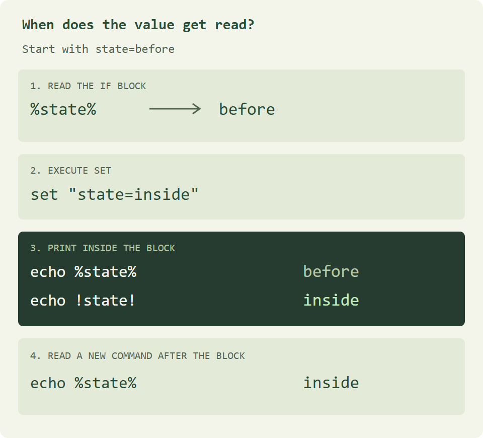

同一段批处理里，`echo` 有时会给出两个看似矛盾的结果。刚在 `if` 里给变量赋了新值，紧接着打印出来的还是旧值。走出括号再打印，新值又出现了。要看清这个过程，先分清百分号在脚本里做的三件事。

## 一个百分号，三种写法

把下面的代码保存为 `basics.cmd`，在文件所在目录打开命令提示符，输入 `basics.cmd`。这些示例也可以保存成 `.bat` 文件。

```bat
@echo off
rem Print a value, a literal percent sign, then two names.
setlocal
set "topic=Windows"
echo %topic%
echo 100%%
for %%F in (alpha beta) do echo %%F
endlocal
```

输出依次为 `Windows`、`100%`、`alpha`、`beta`。在脚本中，`%topic%` 读取环境变量，`100%%` 输出字面的百分号。`for` 则有自己的变量写法，批处理文件里写 `%%F`，直接在命令提示符里输入同一个循环时写 `%F`。[微软的 for 命令说明](https://learn.microsoft.com/zh-cn/windows-server/administration/windows-commands/for)

写注释时，让 `rem` 单独占一行。如果把 `:: 说明` 接在 `echo` 命令末尾，这段说明也会被打印出来。

## 为什么在 if 块里读到旧值

这个脚本只改一次 `state`，用三条 `echo` 对照变量在不同时刻的值。

```bat
@echo off
setlocal EnableDelayedExpansion
set "state=before"

if "%state%"=="before" (
  set "state=inside"
  echo percent=%state%
  echo delayed=!state!
)

echo after=%state%
endlocal
```

```text
percent=before
delayed=inside
after=inside
```



`cmd.exe` 会先读完整个 `if (...)` 命令，再执行里面的语句。读到右括号时，块中的 `%state%` 已经换成了 `before`。即使上一行的 `set` 已经生效，第一条 `echo` 拿到的仍是先前填好的文本。

`setlocal EnableDelayedExpansion` 启用了延迟展开。第二条 `echo` 执行时才取 `!state!` 的值，因此得到 `inside`。右括号之后的 `echo after=%state%` 是一条新读入的命令，自然也读到新值。`endlocal` 结束本段脚本的局部环境。[微软对命令块变量展开时机的说明](https://devblogs.microsoft.com/oldnewthing/20060823-00/?p=29993)

## 带空格的路径怎么传给命令

在脚本旁建一个叫 `Daily Notes` 的目录，放入两个空文件 `first note.txt` 和 `second note.txt`。把下面的代码另存为 `list-notes.cmd`，运行后就能按名称列出这两个文件。

```bat
@echo off
setlocal DisableDelayedExpansion
set "notes=%~dp0Daily Notes"
dir /b /a:-d /o:n "%notes%\*.txt"
endlocal
```

`%~dp0` 是当前批处理文件所在的驱动器和目录，末尾自带反斜杠。即使从另一个目录调用脚本，它也能找到旁边的 `Daily Notes`。`set "notes=..."` 把引号留在赋值语法里，变量的值只包含路径。使用这个值时，再用一对双引号把整个路径参数括起来。处理可能包含感叹号的文件名时，像这里一样关闭延迟展开，可以保留字面的 `!`。

旧脚本里偶尔能看到 `PROGRA~1`，这是 8.3 短文件名。是否生成短名取决于卷设置，具体别名也要以本机为准。维护旧脚本时，可在父目录运行 `dir /x` 查看实际短名。自己写脚本时直接给长路径加引号，就不用猜哪个目录对应 `~1`。[微软的 dir 参数说明](https://learn.microsoft.com/zh-cn/windows-server/administration/windows-commands/dir) · [8.3 短名设置](https://learn.microsoft.com/zh-cn/windows-server/administration/windows-commands/fsutil-8dot3name)

## 常用命令速查

| 想做的事               | 写法                                                      |
| ---------------------- | --------------------------------------------------------- |
| 输出一行文字           | `echo Hello Windows`                                      |
| 关闭脚本的命令回显     | 在开头写 `@echo off`                                      |
| 在局部环境中设置变量   | `setlocal` 后写 `set "name=Sapling"`，结束时写 `endlocal` |
| 按条件执行命令         | `if "%name%"=="Sapling" echo matched`                     |
| 遍历一组值             | `for %%F in (alpha beta) do echo %%F`                     |
| 调用脚本后回到当前脚本 | `call "%~dp0helper.cmd"`                                  |
| 跳到当前脚本的某个标签 | `goto finish`，目标位置单独写一行 `:finish`               |
| 留一行注释             | `rem List the notes`                                      |
