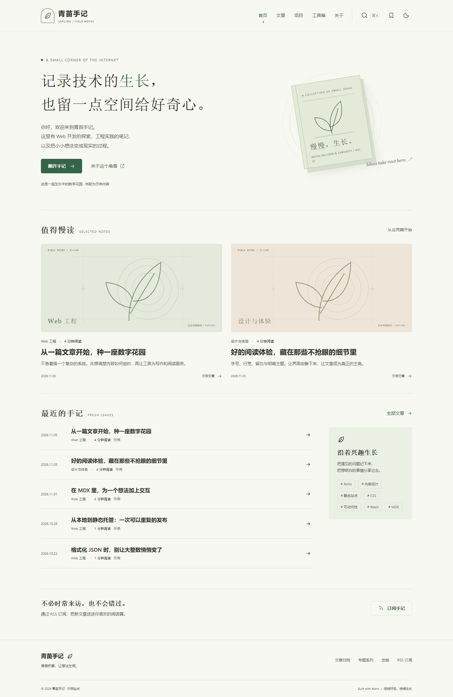

## 项目介绍

这是当前站点的示例项目说明。文章使用 Markdown 与 MDX 编写，在构建时生成静态页面和中文搜索索引。

## 实现重点

- 普通页面通过静态 HTML 展示，React 只用于浏览器工具与文章演示。
- 文章地址使用固定标识，收藏和阅读进度保存在当前浏览器。
- 评论和统计使用可选配置，缺少配置时不发出服务请求。

## 体验截图

下面是本地静态构建的实际桌面首页截图，使用暖白背景、自然绿和杂志式封面卡片。

## 查看当前演示

可以直接浏览[文章列表](/blog/)、[项目主页](/)或[工具箱](/tools/)。此示例没有公开源码仓库，故不展示占位仓库链接。
